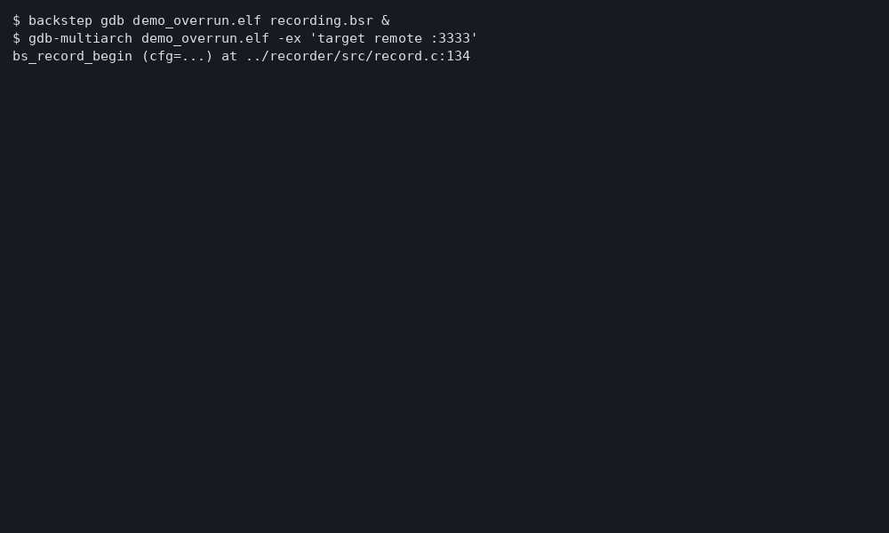

# Backstep

**A rewind button for microcontroller firmware.** Record what your firmware
did on the real chip, then replay that exact execution on your PC and step
*backwards* from a crash to the line that caused it.



*A real session ([how it is made](scripts/make-demo-gif.py)): an
interrupt handler overruns a buffer; after the failure, one reverse
watchpoint finds the store that did it. Walkthrough: [docs/GDB.md](docs/GDB.md).*

> **Status: v0.1.0, early.** Recording on Cortex-M4 (QEMU `mps2-an386`
> and the NUCLEO-F411RE image), exact replay with interrupts and crashes,
> and GDB with reverse execution all work and are tested in CI (see
> [TESTING.md](docs/TESTING.md)). The runs on a real board are queued for
> [hardware verification](docs/HARDWARE_VERIFICATION.md). Firmware that
> uses the FPU records and replays too; RTOS threads come later. Binaries: [releases](https://github.com/mohammed-yassin/Backstep/releases);
> what changed: [CHANGELOG](CHANGELOG.md); what comes next:
> [roadmap](docs/ROADMAP.md).

---

## Why

The hardest firmware bugs are the ones you can't reproduce: a HardFault
once a week in the field, memory corrupted by an interrupt that fired at
the wrong instant, a race that disappears as soon as you add a `printf`.
A crash dump shows *where* the firmware died, not *how it got there*.

Hardware trace tools that let you step backwards exist, but they need
trace pins your board may not have and cost thousands of dollars. Backstep
aims to give every embedded developer the same power for free, on ordinary
Cortex-M chips, using only a debug probe or a serial cable.

## How it works

A microcontroller program is deterministic once you know three things:

1. the **starting state** of RAM and CPU registers,
2. every **value read from a peripheral** (UART, timers, ADC, ...),
3. the **exact instruction** where each **interrupt** arrived (plus DMA data).

The small C99 **recorder** inside your firmware logs only those inputs.
The **host tools** (Rust) run the same firmware binary in a Cortex-M
emulator and feed it the recorded inputs, reproducing the run instruction
for instruction. Because every peripheral value comes from the recording,
the replay needs no peripheral models. A GDB server then lets you step and
continue backwards, and ask "who last wrote this variable?".

Checksums of the CPU state are recorded along the way. If the replay ever
disagrees with them, Backstep stops and says so: it never shows you a
history that did not happen.

See [docs/ARCHITECTURE.md](docs/ARCHITECTURE.md) for the full design.

## Repository layout

| Path | What it is |
|------|------------|
| `recorder/` | On-device recorder library (C99, no dependencies) |
| `host/` | Rust workspace: `backstep` CLI and `backstep-core` library |
| `tools/` | Optional Clang pass for compile-time capture |
| `firmware/` | Example and test firmware for QEMU and NUCLEO-F411RE |
| `scripts/` | CI, QEMU and hardware-in-the-loop test scripts |
| `docs/` | Roadmap, architecture, testing strategy, design decisions |

## Install

Download `backstep` for Linux, macOS or Windows from the
[releases](https://github.com/mohammed-yassin/Backstep/releases) (each
archive also holds the GDB and VS Code guides), or build it from source:

```bash
cd host && cargo build --release      # host/target/release/backstep
```

To record your own firmware, add the C99 recorder in `recorder/` to the
build; `firmware/targets/` has complete examples for QEMU and the
NUCLEO-F411RE. Debugging needs GDB with Arm support (`gdb-multiarch` or
`arm-none-eabi-gdb`).

## Building and testing

You need Rust (1.85 or newer), the Arm GNU toolchain
(`arm-none-eabi-gcc`), `qemu-system-arm`, Python 3 with `pyserial`, a
host C compiler, and (for the optional Clang capture pass) `clang` with
LLVM development files. On Ubuntu 24.04:

```bash
sudo apt-get install gcc-arm-none-eabi libnewlib-arm-none-eabi \
    qemu-system-arm python3-serial build-essential clang llvm-dev gdb-multiarch
```

Run every check exactly as CI does:

```bash
scripts/ci.sh
```

Build the firmware and try the CLI:

```bash
make -C firmware                  # QEMU and NUCLEO-F411RE images
make -C firmware qemu-test        # run the QEMU self-test
cd host && cargo run -p backstep-cli -- info   # host tool version and targets
```

Record a program on QEMU and replay it:

```bash
(cd host && cargo build --release)
qemu-system-arm -machine mps2-an386 -cpu cortex-m4 -nographic \
    -semihosting-config enable=on,target=native,arg=w=2 \
    -kernel firmware/build/qemu-mps2-an386/replay_test.elf   # writes recording.bsr
host/target/release/backstep inspect recording.bsr
host/target/release/backstep replay firmware/build/qemu-mps2-an386/replay_test.elf recording.bsr
```

Or ask it who wrote a variable last, and see its interrupts and faults
([guide](docs/QUERIES.md)):

```bash
host/target/release/backstep why firmware/build/qemu-mps2-an386/replay_test.elf recording.bsr g_hash
host/target/release/backstep timeline firmware/build/qemu-mps2-an386/replay_test.elf recording.bsr
```

Debug the recording with GDB, forwards and backwards
([guide](docs/GDB.md)):

```bash
gdb-multiarch firmware/build/qemu-mps2-an386/replay_test.elf \
    -ex "target remote | host/target/release/backstep gdb --stdio firmware/build/qemu-mps2-an386/replay_test.elf recording.bsr"
(gdb) watch g_hash
(gdb) continue
(gdb) reverse-continue
```

### Supported hardware

| Board | Status |
|-------|--------|
| QEMU `mps2-an386` (Cortex-M4) | Reference target for automated tests |
| ST NUCLEO-F411RE (STM32F411RE) | First real board; [hardware test procedure](docs/HARDWARE_VERIFICATION.md) |

More Cortex-M boards follow once replay works end to end.

## Contributing

Contributions are welcome. Please read [CONTRIBUTING.md](CONTRIBUTING.md)
first: every change needs tests, and every pull request must pass
`scripts/ci.sh` and CI.

## Related projects

- [mkdbg](https://github.com/JialongWang1201/mkdbg): crash forensics and
  probe-free debugging for Cortex-M. Backstep plans to interoperate with
  it (milestone M10).
- [Renode](https://renode.io) and [QEMU](https://www.qemu.org): full-system
  emulators. Backstep replays real recordings instead of simulating
  peripherals.

## License

[MIT](LICENSE)
